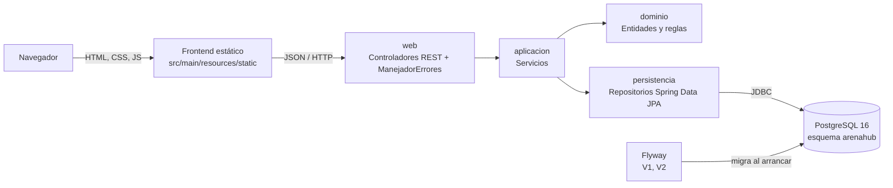

# Informe técnico — ArenaHub

## 1. Resumen ejecutivo

ArenaHub es un sistema web para consultar la disponibilidad de escenarios deportivos y
reservarlos por franjas de una hora. El MVP implementa las **8 historias de usuario** del
backlog (HU1–HU8) de punta a punta: interfaz web, API REST en Spring Boot y PostgreSQL 16.

El problema duro elegido es la **concurrencia**: ante solicitudes simultáneas por el mismo
escenario, fecha y franja, solo una reserva puede quedar confirmada. La garantía la da la base de
datos con un índice único parcial, y se demuestra con una prueba de integración que lanza
**20 solicitudes a la vez**: 1 confirmada, 19 rechazadas con `409` y 1 sola fila persistida.

| Indicador | Valor |
|---|---|
| Historias de usuario implementadas | 8 de 8 |
| Pruebas automatizadas | 58 (22 unitarias, 36 de integración) |
| Defectos encontrados y corregidos en la revisión | 2 (D1, D2) |
| Deuda técnica registrada | 10 ítems, priorizados ([`deuda-tecnica.md`](./deuda-tecnica.md)) |
| Comandos para ejecutar el sistema | 2 tras clonar (`docker compose up -d`, `./mvnw spring-boot:run`) |

**Equipo:** Ana Sofía Siachoque (bases de datos y SQL) y Andres Felipe Rubiano Duarte
(desarrollo en Java).

## 2. Arquitectura y diseño

### 2.1 Vista general



Arquitectura por capas: cada capa depende solo de la de abajo. El frontend lo sirve el mismo
Spring Boot, por lo que el sistema es un solo proceso más la base de datos.

| Capa | Paquete | Responsabilidad |
|---|---|---|
| Web | `com.arenahub.web` | Endpoints REST, validación de entrada (`@Valid`), traducción de excepciones a HTTP |
| Aplicación | `com.arenahub.aplicacion` | Casos de uso y transacciones: registro, autenticación, disponibilidad, reservas, escenarios |
| Dominio | `com.arenahub.dominio` | Entidades y reglas de negocio (`Reserva.confirmar`, `Reserva.cancelar`, `EscenarioDeportivo.admiteReservas`) |
| Persistencia | `com.arenahub.persistencia` | Repositorios y consultas JPA |
| Base de datos | `db/migration` | Esquema 3NF, restricciones e índice del problema duro |

### 2.2 Modelo de datos (3NF)

Cuatro tablas: `usuario`, `escenario_deportivo`, `franja_horaria` y `reserva`. La reserva solo
guarda llaves foráneas, fecha y estado; no repite nombres ni horas. El detalle está en
[`esquema-bd.md`](./esquema-bd.md) y el modelo de dominio en [`modelo-dominio.md`](./modelo-dominio.md).

Restricciones principales:

| Restricción | Garantiza |
|---|---|
| `uq_usuario_email` | Un correo por cuenta (HU1) |
| `uq_escenario_nombre` | Nombres de escenario únicos (HU7) |
| `chk_escenario_capacidad` | Capacidad nula o mayor que 0 |
| `uq_franja_horaria`, `chk_franja_orden` | Franjas sin repetir y con inicio antes del fin |
| `uq_reserva_confirmada` (índice único parcial) | Una sola reserva `CONFIRMADA` por escenario, fecha y franja |

### 2.3 Decisiones de diseño

| Decisión | Motivo | Alternativa descartada |
|---|---|---|
| PostgreSQL 16 (en lugar de MySQL, desde la semana 5) | Soporta índices únicos parciales | MySQL: requeriría columnas generadas o triggers |
| Garantía de concurrencia en la base de datos | Es atómica y no depende del orden de los hilos de Java | `synchronized` (no escala a varias instancias); `SELECT … FOR UPDATE` (más bloqueo y más código) |
| Franjas fijas de una hora (06:00–22:00) | Reduce "no solapar horarios" a "no repetir franja", que resuelve un índice único | Horarios libres con restricción de exclusión sobre rangos: más complejo para el MVP |
| Flyway | El esquema se versiona con el código y las pruebas parten de una base limpia | Scripts SQL manuales |
| BCrypt con `spring-security-crypto` | Contraseñas nunca en texto plano | Spring Security completo: más configuración de la necesaria |
| Frontend sin frameworks servido por Spring Boot | Mantiene el contrato de ejecución en 2 comandos | React o Angular: otro servidor y otro build |
| Docker Compose para la base de datos | Mismo entorno en cualquier equipo | Instalación local de PostgreSQL |

## 3. Implementación

### 3.1 API REST

| HU | Endpoint | Respuestas |
|---|---|---|
| HU1 | `POST /api/usuarios` | 201, 409 correo repetido, 400 |
| HU2 | `POST /api/usuarios/login` | 200 con token y usuario, 401 sin indicar qué campo falló |
| HU3 | `GET /api/escenarios/disponibilidad?fecha=` | 200, solo escenarios activos, franjas con `ocupada` |
| HU4 | `POST /api/reservas` | 201, 409 franja ocupada, 422 regla de negocio, 404 |
| HU5 | `PATCH /api/reservas/{id}/cancelar` | 200, 422 reserva ajena o ya cancelada |
| HU6 | `GET /api/reservas?usuarioId=` | 200 |
| HU7 | `POST /api/escenarios` | 201, 409 nombre repetido, 400 |
| HU8 | `PATCH /api/escenarios/{id}/estado` | 200 |

Los errores tienen un cuerpo uniforme `{status, error, mensaje}` gracias a `ManejadorErrores`.

### 3.2 Problema duro: concurrencia en reservas

```sql
CREATE UNIQUE INDEX uq_reserva_confirmada
    ON reserva (escenario_id, fecha, franja_id)
    WHERE estado = 'CONFIRMADA';
```

1. `ReservaService.crear` hace una verificación previa (`existsBy…`) que solo sirve para dar un
   mensaje rápido en el caso secuencial.
2. Bajo concurrencia, varias solicitudes pasan esa verificación al mismo tiempo. Al insertar
   (`saveAndFlush`), PostgreSQL acepta la primera y rechaza las demás por el índice.
3. El servicio identifica la violación por el nombre `uq_reserva_confirmada` y la traduce a
   `ConflictoException` → **409 Conflict**.
4. Como el índice es **parcial**, una reserva `CANCELADA` no bloquea la franja (HU5).
5. El frontend muestra el 409 como "Alguien reservó primero" y recarga la disponibilidad.

Detalle y evidencia exigida: [`problema-duro.md`](./problema-duro.md).

### 3.3 Frontend

HTML, CSS y JavaScript sin frameworks en `src/main/resources/static` (`index.html`,
`css/arenahub.css`, `js/app.js`). Pantallas: acceso, reservar, mis reservas y escenarios
(administración). Es *responsive* (computador y celular), con foco de teclado visible y respeta
la preferencia de movimiento reducido. Uso: [`manual-usuario.md`](./manual-usuario.md).

## 4. Pruebas y calidad

| Tipo | Clases | Pruebas | Qué cubren |
|---|---|---|---|
| Unitarias de dominio | `ReservaTest` | 8 | Reglas de `Reserva` y `FranjaHoraria` (escenario en mantenimiento, fechas pasadas, cancelación propia y ajena, doble cancelación) |
| Unitarias de servicios (Mockito) | `AutenticacionServiceTest`, `EscenarioServiceTest`, `ReservaServiceTest` | 14 | Casos de uso sin levantar Spring |
| Integración (API + PostgreSQL real) | 8 clases en `integracion/` | 36 | HU1–HU8 contra criterios de aceptación, casos borde y concurrencia |
| **Total** | | **58** | |

Prueba clave: `CrearReservaIntegracionTest.veinteSolicitudesSimultaneasSoloConfirmanUna`.
20 hilos esperan en un `CountDownLatch` y se liberan a la vez contra la API real. Verifica
1 respuesta 201, 19 respuestas 409 y exactamente 1 fila en `reserva`.

Calidad adicional:
- Revisión de código con SOLID y GRASP ([`revision-codigo.md`](./revision-codigo.md)): 2 defectos corregidos con prueba, 3 refactorizaciones sin cambiar el comportamiento observable y 5 hallazgos registrados como deuda.
- Las pruebas usan fechas relativas (`LocalDate.now().plusDays(n)`) para no caducar con el calendario.
- Base de pruebas aislada en el esquema `arenahub_test`, recreado en cada ejecución.

Comando: `./mvnw verify` (con la base de datos arriba).

## 5. Limitaciones conocidas

Las tres de mayor impacto están registradas como deuda técnica, con plan de mejora en
[`deuda-tecnica.md`](./deuda-tecnica.md):

- **DT-1:** el token del inicio de sesión no se valida; `usuarioId` viaja en el cuerpo.
- **DT-2:** el backend no verifica el rol de administrador en HU7 y HU8.
- **DT-3:** al desactivar un escenario, sus reservas futuras siguen confirmadas.

El RNF-1 (consulta de disponibilidad < 400 ms p95 con 50 usuarios) está definido pero aún no
medido (DT-8).

## 6. Lecciones aprendidas

1. **Las reglas críticas van donde no se pueden saltar.** Un `if` en Java no protege contra
   solicitudes simultáneas; un índice único en la base de datos sí.
2. **Una prueba concurrente real vale más que una secuencial.** Sin la barrera de sincronización
   la prueba pasaría aunque el sistema tuviera el error.
3. **Elegir el motor de base de datos es una decisión de diseño.** El cambio de MySQL a
   PostgreSQL vino de una necesidad concreta: los índices parciales.
4. **Dividir el trabajo por capas exige acordar el contrato.** Separar BD/SQL y Java funcionó
   porque las tablas, restricciones y respuestas se acordaron antes de implementarlas.
5. **Registrar la deuda es parte de la calidad.** Saber qué falta y por qué es mejor que
   esconderlo.
6. **El entorno también se documenta.** Los problemas reales para ejecutar el proyecto en
   Windows (`Path` y `ComSpec` dañados) quedaron en la guía de instalación para que no se repitan.
