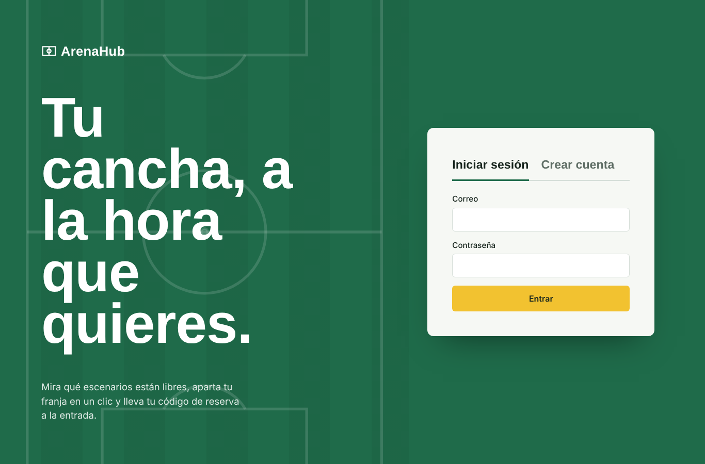
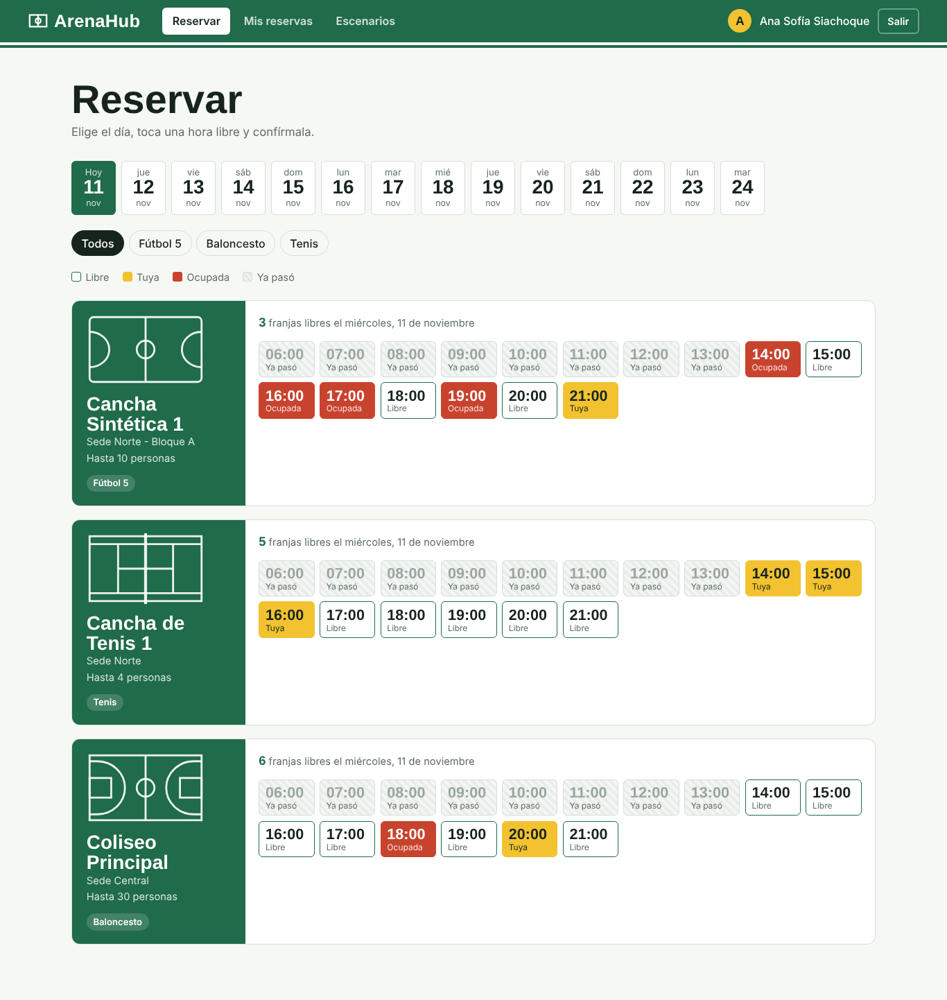
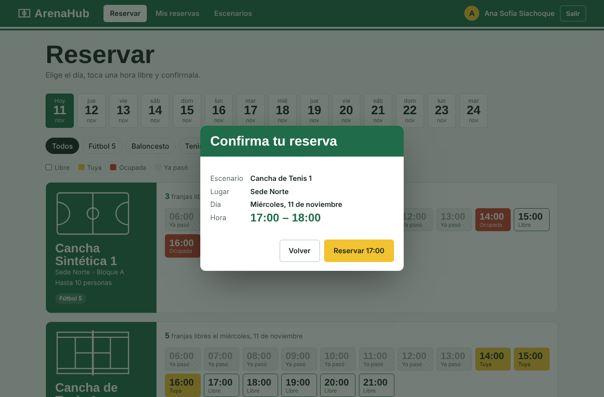
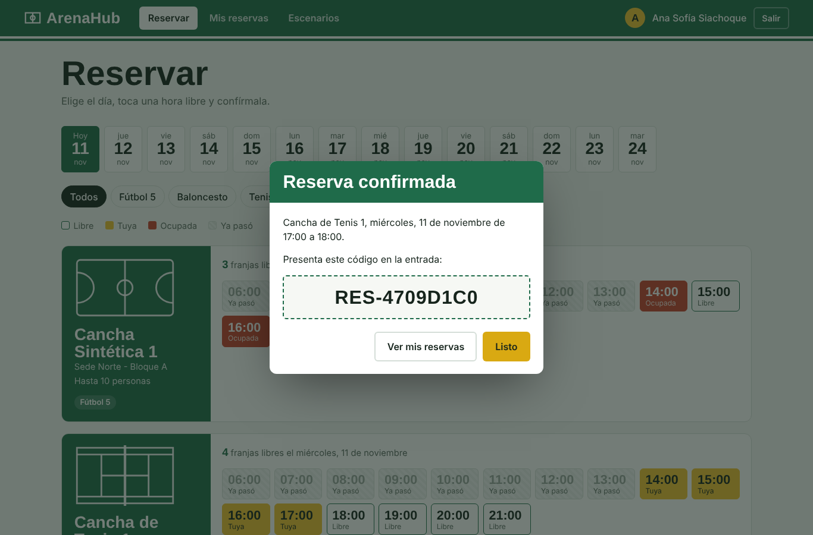
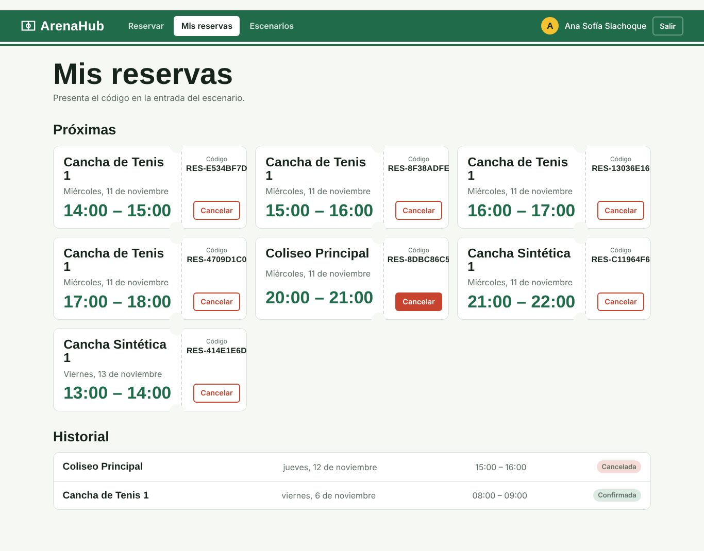
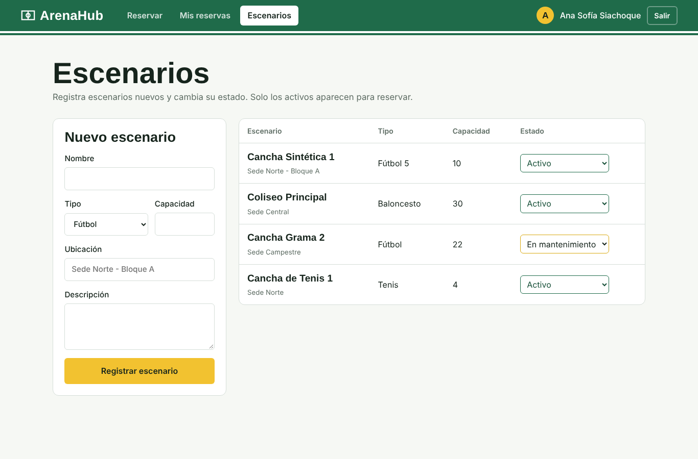

# Manual de usuario — ArenaHub

ArenaHub permite ver qué escenarios deportivos están libres, reservar una franja de una hora y
gestionar esas reservas. La interfaz está en **http://localhost:8080** una vez levantada la
aplicación (ver [`guia-instalacion.md`](./guia-instalacion.md)).

## 1. Roles y permisos

| Rol | Qué puede hacer | Cómo se obtiene |
|---|---|---|
| Jugador | Registrarse, iniciar sesión, consultar disponibilidad, reservar, cancelar sus reservas y ver su historial | Al crear la cuenta desde la interfaz |
| Entrenador | Lo mismo que el jugador (el rol existe en el modelo; no tiene pantallas propias en el MVP) | Cambio de rol en la base de datos |
| Administrador | Todo lo anterior, más registrar escenarios y cambiar su estado | Cambio de rol en la base de datos ([guía, punto 3.3](./guia-instalacion.md#33-crear-un-usuario-administrador)) |

> En el MVP el control de rol lo hace la interfaz, que solo muestra la pestaña **Escenarios** a los
> administradores. El backend todavía no lo verifica (deuda técnica DT-2).

## 2. Flujos principales

### 2.1 Crear una cuenta e iniciar sesión (HU1, HU2)

1. En la pestaña **Crear cuenta**, escribir nombre completo, correo y una contraseña de al
   menos 8 caracteres.
2. Pulsar **Crear cuenta**. La sesión se inicia automáticamente.
3. Las siguientes veces, usar la pestaña **Iniciar sesión** con correo y contraseña.

Mensajes posibles:
- *"Ya existe una cuenta con ese correo. Inicia sesión."*: el correo ya está registrado.
- *"El correo o la contraseña no coinciden."*: credenciales incorrectas. Por seguridad, no se
  indica cuál de los dos campos falló.

### 2.2 Consultar disponibilidad (HU3)

1. Entrar a **Reservar**.
2. Elegir un día en la fila de fechas (hoy y los 13 días siguientes).
3. Opcional: filtrar por tipo de escenario (Fútbol 5, Baloncesto, Tenis…).

Cada escenario muestra su plano, ubicación y capacidad, y sus 16 franjas de una hora
(06:00 a 22:00):

| Color | Significado |
|---|---|
| Borde verde, fondo blanco | **Libre**: se puede reservar |
| Amarillo | **Tuya**: ya la reservaste |
| Rojo | **Ocupada**: la reservó otra persona |
| Rayado gris | **Ya pasó**: la hora de inicio ya pasó (solo el día de hoy) |

Solo aparecen los escenarios en estado **Activo**. Los que están en mantenimiento o inactivos
no se pueden reservar.

### 2.3 Reservar (HU4)

1. Tocar una franja **Libre**.
2. Revisar el resumen (escenario, lugar, día y hora) y pulsar **Reservar HH:MM**.
3. Aparece el **código de reserva** (por ejemplo `RES-8DBC86C5`). Ese código se presenta en la
   entrada del escenario.

Si otra persona confirma la misma franja un instante antes, aparece **"Alguien reservó
primero"** y la disponibilidad se actualiza sola. Es el comportamiento esperado: el sistema
nunca permite dos reservas confirmadas para el mismo escenario, fecha y franja.

### 2.4 Ver y cancelar reservas (HU5, HU6)

En **Mis reservas**:
- **Próximas**: reservas confirmadas desde hoy en adelante, como tiquetes con su código.
- **Historial**: reservas pasadas y canceladas, con su estado.

Para cancelar: pulsar **Cancelar** en el tiquete y confirmar con **Cancelar reserva**. La
franja queda libre de inmediato para otras personas. Solo se pueden cancelar reservas propias.

### 2.5 Administrar escenarios (HU7, HU8)

Solo para administradores, en la pestaña **Escenarios**:

- **Registrar un escenario:** completar nombre, tipo, ubicación y, si se quiere, capacidad y
  descripción; pulsar **Registrar escenario**. Queda **Activo** y aparece de inmediato en
  **Reservar**. El nombre no se puede repetir y la capacidad debe ser mayor que cero.
- **Cambiar el estado:** usar el selector de la columna **Estado**:
  - **Activo**: visible para reservar.
  - **En mantenimiento** o **Inactivo**: deja de aparecer en **Reservar**.

> Al desactivar un escenario, sus reservas futuras siguen confirmadas (DT-3). Avisar a los
> usuarios afectados mientras se resuelve.

## 3. Casos de uso

| Caso | Actor | Resultado esperado |
|---|---|---|
| Reservar la cancha para un partido el sábado a las 18:00 | Jugador | Reserva confirmada con código |
| Dos personas intentan la misma franja a la vez | Jugadores | Una obtiene la reserva; la otra ve "Alguien reservó primero" |
| Ya no voy a jugar | Jugador | Cancela; la franja vuelve a estar libre |
| La cancha entra en mantenimiento | Administrador | La pasa a **En mantenimiento**; desaparece de **Reservar** |
| Se abre una cancha nueva | Administrador | La registra; queda disponible al instante |

## 4. Consejos y preguntas frecuentes

**¿Por qué no veo un escenario que sé que existe?**
Está en mantenimiento o inactivo. Un administrador puede volver a activarlo.

**¿Puedo reservar varias horas seguidas?**
Sí, reservando cada franja de una hora por separado.

**¿Puedo reservar una fecha pasada?**
No. El sistema lo rechaza con *"No se puede reservar en una fecha pasada"*.

**¿Por qué una franja de hoy aparece como "Ya pasó"?**
Su hora de inicio ya pasó. La interfaz la bloquea para evitar reservas inútiles.

**¿Cuánto dura la sesión?**
Hasta pulsar **Salir**. La sesión se guarda en el navegador y sigue abierta al recargar la página.

**Me volví administrador y no veo la pestaña Escenarios.**
Cerrar sesión y volver a entrar: el rol se carga al iniciar sesión.

**La página dice "No hay conexión con el servidor".**
La aplicación se detuvo. Ver la [guía de instalación](./guia-instalacion.md#4-solución-de-problemas).
